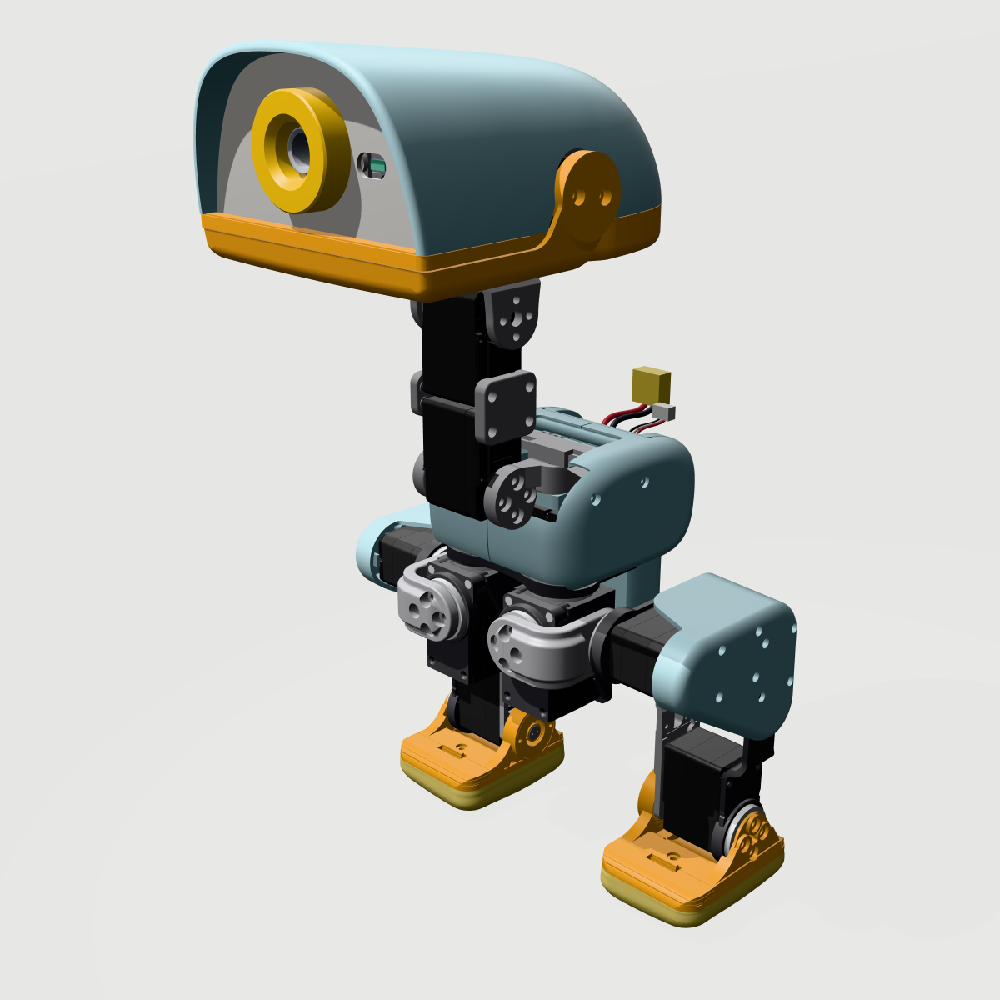

# Frankenduck CAD



Parametric CAD for the Frankenduck robot, built with Text to CAD. The project
includes the complete assembly, editable part models, purchased-component
representations, joint animation and individual files for 3D printing.

Frankenduck is inspired by the [Microduck](https://github.com/pollen-robotics/microduck)
from [Pollen Robotics](https://github.com/pollen-robotics). All rights to the
Microduck design belong to Pollen Robotics.

**Here to print?** Start with [printable/](printable/README.md). It contains
52 individual millimetre 3MF files with matching STL files and a
[parts list](printable/PARTS.csv).

## Build and view

Install [uv](https://docs.astral.sh/uv/), then run these commands from the
repository root. Setup creates a local Python 3.12 environment with pinned CAD
dependencies.

```sh
./setup.sh
./cad build
./cad check fast
./cad view
```

The assembly is saved as `STEP/frankenduck.step`. Keep its `.step.json` sidecar
beside it to retain joints, poses and animation. The viewer prints its local
address and binds to `0.0.0.0`; other computers on the same network can use
the host's LAN address and that port.

## Work on the model

Edit individual models in `src/parts/` and their placements in
`src/frankenduck.py`. Use millimetres and explicit datums. Rebuild the assembly
after editing a part, then run the checks that cover the change.

| Command | Purpose |
| --- | --- |
| `./cad build` | Build the assembly STEP and sidecar |
| `./cad check fast` | Check component roles, joint declarations and animation |
| `./cad check radxa` | Check the board mount, GPIO allowances and cooler fit |
| `./cad check full` | Run all maintained checks, including assembly inventory |
| `./cad status` | Show current, stale, missing or failed results |
| `./cad parts` | List component roles, quantities and print selection |
| `./cad export print` | Create or reuse the complete printable bundle |
| `./cad review radxa` | Prepare the colored GPIO and cooler clearance model |
| `./cad review pod` | Render battery holder views and exact sections with quality findings |
| `./cad view` | Start or reuse the LAN viewer |

Passing checks are reused while their inputs stay unchanged. Builds, print
exports and review models are explicit operations. Use `--force` on a build,
check or export when a deliberate rerun is needed. Current reports and logs
are in `reports/latest/`.

The full suite checks the saved rest pose, all 1,702 recorded walking/sitting
keyframes for battery clearance, and the battery's lift-and-rearward removal at
the home pose. It does not perform a continuous motion sweep or establish physical
fit, printed strength, cable bending or thermal performance.

## Parts and printing

[source/components.json](source/components.json) defines each model's role,
geometry fidelity, material hint and print status. The assembly contains
53 printed parts and 51 purchased-component occurrences. Electronics, servos,
horns, batteries and the heatsink are hardware representations. Colored
clearance volumes belong only to the review model.

Regenerate the printable bundle with:

```sh
./cad build
./cad export print
```

Only active printed parts are exported. Each 3MF uses millimetres, keeps the
assembly's axes, is centered in X/Y and sits at Z=0. Choose print orientation,
material, supports and slicer settings in your slicer. The bearing inner caps
are printed parts with an unspecified material.

[printable/manifest.json](printable/manifest.json) records dimensions, source
hashes, mesh checks and export settings. Print status is currently `unreviewed`.
Numerical seam warnings are recorded there; open boundaries and winding errors
fail export. Failed exports preserve the previous complete bundle.

## Design notes

The Radxa Cubie A7Z sits with USB-C facing up. Its mount provides GPIO space
for individual jumper plugs and an upward cable path, plus a representation
of the official Radxa 6530B cooler. Dimensions, fastener details and modeling
assumptions are in [docs/design.md](docs/design.md).

The assembly uses a Zeee 2S 2200 mAh LiPo pack in a printed holder behind the
trunk plate. The holder is open at the top; the pack lifts out and then slides
away rearward, with no lid or latch. Two holder arms are screwed to the trunk
plate with four M3 screws into heat-set inserts. The holder and both 1 mm body
shells keep the body's outline. The pack is a reference model at its published
size and is excluded from the print set; physical fit, retention and printed
strength remain unverified. See [the LiPo holder notes](docs/lipo-battery.md)
and [the body shell notes](docs/body-shells.md). The PARKSIDE stick pod was the
default up to commit `e883d4e`; the PAP 204 A1 backpack revision is commit
`a94355e`.

## Repository layout

| Path | Contents |
| --- | --- |
| [src/](src/README.md) | Assembly, animation, part models and shared geometry helpers |
| `source/` | Assembly declarations, component catalog, variants, fonts and component documentation |
| `STEP/imported/` | Purchased-component STEP inputs used by the models |
| `STEP/` | Generated assembly, component and review STEP files |
| [printable/](printable/README.md) | Committed 3MF and STL files, quantities and export manifest |
| [checks/registry.json](checks/registry.json) | Check purposes, dependencies and coverage |
| [tools/](tools/README.md) | Workflow, print export and viewer support |
| `review/` | Model images |
| `docs/images/` | README render of `STEP/frankenduck.step`, made with `.venv/bin/cadgen step snapshot STEP/frankenduck.step docs/images/frankenduck.png --render '{"quality":"final","camera":"45:20"}' --width 1200 --height 1200` |
| [jigs/](jigs/README.md) | Printed aids for measuring the robot (hip roll foot board) |
| `reports/latest/` | Generated check results and logs |
| `scratch/` | Ignored temporary investigations |

Read [AGENTS.md](AGENTS.md) before automated changes. Commit model changes with
their matching printable bundle when updating a print revision. Environments,
caches, generated working STEP files and temporary reports stay out of Git.
